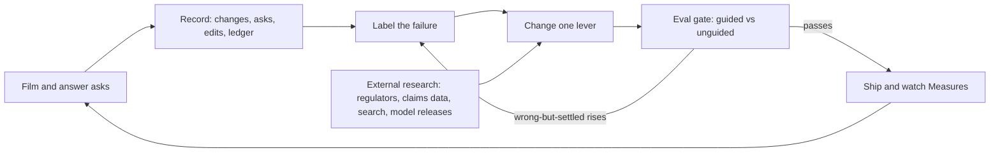

# The research loop: how 100proof gets more accurate

100proof does not retrain Muse Spark. Meta ships the model; we ship everything around it — the prompts, the
schemas, the evidence asks, the pricing rules, and the choice of when to believe a line. Those are updated on a
loop driven by data the product already records. This document is that loop. Its target is narrow:

**Get every line as accurate as it can be without a receipt. A receipt then does the one job only it can do:
confirm that this item belongs to this person.**

## The accuracy mark

Every line carries a mark (`apps/web/lib/accuracy-mark.ts`), computed from signals a reviewer can check, never
from the model's own confidence and never shown as a percentage:

| Mark | Meaning |
| --- | --- |
| Needs evidence | Count, model, or price is not settled |
| Estimated from video | Count settled, priced, and seen on camera, with the model still open. Large items are priced this way instead of asking for a label |
| Settled on camera | Count and model settled, priced |
| Strong — no receipt | Settled and priced, plus at least two corroborations: seen more than once, described by the owner, label or photo checked, serial recorded, price paid from the owner, or priced as the exact product |
| Receipt verified | A receipt photo or a Connections match set the price paid on this line. This confirms individuality — this item, this owner. A typed or spoken price alone does not |
| Entered by you | Typed by the person, not from the scan |

Ten signals feed the mark (accuracy mark v2): seen on camera, seen more than once, count settled, brand and
model settled, owner described it, label or photo checked, serial recorded, price paid from the owner, priced
as the exact product, priced at all. The mark,
its signals, and the next evidence that would raise it are on each line, in Measures, and in the claim file.
"Strong without a receipt" — settled-or-strong lines with no receipt, as a share of no-receipt lines — is the
headline number. It is the thing the loop exists to move.

## The loop

1. **Record.** Every session already writes what the loop needs: `item_events` and per-line changes with their
   source, evidence requests asked and skipped, model calls in `cost_ledger` (call, model, ok, latency, bytes,
   audio — no content), and the accuracy-mark distribution in Measures.
2. **Label the failure.** A correction is a label. When a person edits, deletes, or re-prices a settled line, or
   a label/receipt changes its model, that line was wrong in a specific way. Sort it into the taxonomy below.
3. **Change one lever.** One change per cycle, so the eval can attribute the effect: a prompt line, a schema
   field, an ask threshold, a pricing rule, the clip guidance copy, or the pinned model version. The
   hypothesis is written first in `docs/EXPERIMENTS.md`. New concepts are adopted only when they answer a
   labelled failure better than the current lever on the same cases — novelty is not a metric.
4. **Eval gate.** `docs/EVAL.md`: the same recorded walkthroughs, unguided and guided. A change ships only if
   count-right and identity-right do not fall, value-within-25% does not fall, and wrong-but-settled does not
   rise. Wrong-but-settled rising blocks the change, whatever else improved.
5. **Ship and watch.** Measures per inventory show whether real sessions move: strong-without-receipt share,
   signals per line, asks skipped, edits after settle, clip-review latency and failures.
6. **Refresh the outside world.** On a cycle, not on a whim: regulator guidance (NAIC, TDI, CDI), claims-cycle
   research (J.D. Power), what people search for, competitor claims, pricing-source freshness, and Meta model
   releases. Model upgrades are pinned, evaluated against the same cases, and only then adopted — the version is
   recorded in the commit trailer (`Meta-Models:`) and the build log.

## Failure taxonomy

| Failure | Seen in | First lever |
| --- | --- | --- |
| Line missed entirely | Truth case, "add item" | Clip guidance; list prompt coverage |
| Same object listed twice | Merge across clips | Sightings and merge rules |
| Count wrong | Wider-clip answer, hand edit | When the wider ask fires |
| Brand or model wrong | Label photo changes the line | When the label ask fires; label reading |
| Priced on the wrong comparable | Receipt or label reprices | Exact-vs-comparable choice; pricing prompt |
| Cash value off | Receipt with a date vs depreciation | Age capture; depreciation bands by category |
| Grouped line hides a valuable piece | Hand split, high-value edit | Grouping threshold behaviour (internal) |
| Narration attached to the wrong line | Owner edit | Transcript-to-line attachment |
| Ask wasted | Request skipped ("Leave it") | Ask ranking and wording |
| Ask never fired | Open line, no request | Threshold behaviour (internal) |

## What a receipt teaches

When a receipt arrives, three deltas are worth keeping in aggregate, with no names, addresses, or images:
the model it confirmed or changed, the price paid against our replacement estimate, and the purchase date
against our age and depreciation. By category, those deltas calibrate the comparable choice and the
depreciation bands — the two places a no-receipt line is most likely to be wrong. The receipt stays the
owner's document; only the size and direction of the delta leave the line, and only in counts.

## Guardrails

- Untrusted text is data, never instructions. Corrections are labels about lines, not commands.
- No video, image, transcript, or address becomes an eval case without the owner's explicit opt-in, and cases
  stay off git (`apps/web/scripts/eval/cases/` is ignored).
- Aggregates only for calibration: category, signal, delta band. No coordinates are ever stored, so none can leak.
- The mark never becomes a percentage, and no change may make a line look more certain than its signals.
- Every lever change is one commit with the eval result in the PR (see `docs/ENGINEERING_STANDARDS.md`).

## Cadence during the hackathon

- **Per session (Steven, phone):** run the `docs/EVAL.md` checklist; copy Measures into the table. That is the
  live read on strong-without-receipt.
- **Per change (agent):** pick the top failure, change one lever, run the eval gate, update this taxonomy if a
  failure does not fit it.
- **Daily:** read the day's corrections and skipped asks; re-rank the failure list.
- **On a Meta model release:** pin the new version in a branch, run the full case set, adopt only on a pass.
- **Weekly (post-hackathon):** external research refresh — search demand, regulator guidance, claims data,
  pricing sources — into `docs/GTM.md`, with dates.
